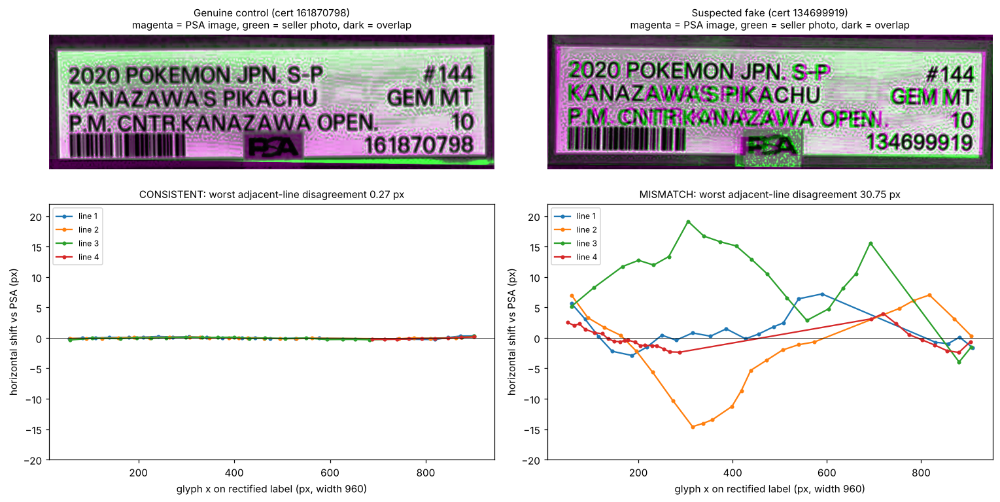

# PSA Label Alignment Check

[中文說明 →](README.zh-TW.md)

An agent skill and command-line tool that checks whether a **PSA-graded slab in a
seller's photo carries a genuine PSA label**. It compares the label's text
layout, glyph by glyph, against PSA's official image for the same cert.

Counterfeit slabs copy a real cert number, a working QR code, and often PSA's own
photo, so "the cert looks up fine" proves nothing. What counterfeiters rarely
reproduce is PSA's exact typesetting.



## How it works

1. **Rectify the labels.** The tool finds the red label frame in both images
   and warps each label to a canonical 960 × 291 px rectangle.
2. **Measure the glyphs.** Every glyph and digit from PSA's label is located in
   the seller's label by normalised cross-correlation, with sub-pixel
   refinement.
3. **Remove global distortion.** One global homography absorbs camera angle
   and lens distortion, and the glyphs are measured again.
4. **Score.** Two adjacent text lines are compared at the same horizontal
   positions:
   - A re-photograph of the *same* printed label moves every line together.
     The disagreement is below 1 px.
   - A re-typeset label shows lines drifting in different directions, by tens
     of pixels.

| verdict | worst adjacent-line disagreement | meaning |
|---|---|---|
| `CONSISTENT` | ≤ 4 px | Text layout matches PSA. The label is very likely a genuine PSA print. |
| `MISMATCH` | ≥ 8 px | Text is typeset differently from PSA. This indicates a reprinted or counterfeit label. |
| `INCONCLUSIVE` | 4–8 px, or too few glyphs matched | Get a sharper, more frontal photo and run again. |

Calibration so far, with the label 960 px wide:

| case | result |
|---|---|
| Genuine slab | **0.27 px** |
| Genuine slab vs a PSA image of a different cert of the same card | 0.22 px |
| Suspected fake | **30.75 px** |

The full table is in [`references/method.md`](skills/psa-label-alignment/references/method.md).

## Quick start

```bash
pip install -r requirements.txt
python skills/psa-label-alignment/scripts/psa_label_check.py \
    --ref  examples/01-reprinted-label-suspect/psa_front.png \
    --test examples/01-reprinted-label-suspect/listing_front.jpg \
    --test-back examples/01-reprinted-label-suspect/listing_back.jpg --cert 134699919 \
    --out out/
# -> {"verdict": "MISMATCH", "max_adjacent_line_disagreement_px": 30.75, ...}
```

The tool writes these files to the output folder:

- `report.json`
- `overlay.png`: magenta is PSA, green is the seller photo
- `displacement.png`: per-line shift curves
- the two rectified labels

| exit code | meaning |
|---|---|
| 0 | consistent |
| 1 | mismatch |
| 2 | inconclusive |
| 3 | error |

Useful flags:

- `--ignore-cert-line`: use when the reference is a PSA image of a **different
  cert of the same card**. PSA typesets the description lines identically, so
  only the cert-number row is skipped.
- `--ref-corners` / `--test-corners "x,y;x,y;x,y;x,y"`: set the red-frame
  corners by hand if automatic detection fails. Give them in the order
  top-left, top-right, bottom-right, bottom-left.

## Use it as an agent skill

The skill lives in [`skills/psa-label-alignment/`](skills/psa-label-alignment/SKILL.md)
and uses the open **Agent Skills** format: a `SKILL.md` with YAML front matter,
plus `scripts/` and `references/`.

| Agent | How to install |
|---|---|
| Claude Code | Copy `skills/psa-label-alignment` to `~/.claude/skills/` (all projects) or `<project>/.claude/skills/` (one project). |
| Claude apps | Zip the `psa-label-alignment` folder and upload it as a custom skill. |
| Codex, Cursor, Gemini CLI, and other agents | Add this repo to the workspace. They read [`AGENTS.md`](AGENTS.md), which points to the skill. |
| Any other agent | It only needs to run one Python command and read a JSON report, so any agent that can run a shell can use it. |

Then ask your agent, for example: *"Is this PSA 10 on Mercari real? Here is the
PSA cert image."*

## Examples

| | case | verdict |
|---|---|---|
| [01-reprinted-label-suspect](examples/01-reprinted-label-suspect/) | A 0-rating marketplace listing at about 70% of market price, filed under the wrong category | **MISMATCH**, 30.75 px |
| [02-genuine-control](examples/02-genuine-control/) | A long-standing seller with 1,000+ ratings, priced at market | **CONSISTENT**, 0.27 px |

Run both with `python tests/test_examples.py`.

## Limits

- The tool checks the **label only**. It cannot detect a genuine slab that was
  opened and had a different card put inside.
- It needs a real photo of the label. If a seller only shows PSA's own images,
  that proves nothing.
- Its thresholds are provisional, because they were calibrated on two slabs.
  Pull requests with more labelled examples are welcome.
- It is built for the standard red-bordered PSA label, and measures horizontal
  layout only.
- It is a screening aid, not an authentication service. For valuable cards,
  also use the marketplace's authentication option or a professional.

## License

The code is under the MIT license. The example images are third-party
photographs, included only to demonstrate and test the method. Seller
identities have been removed.
