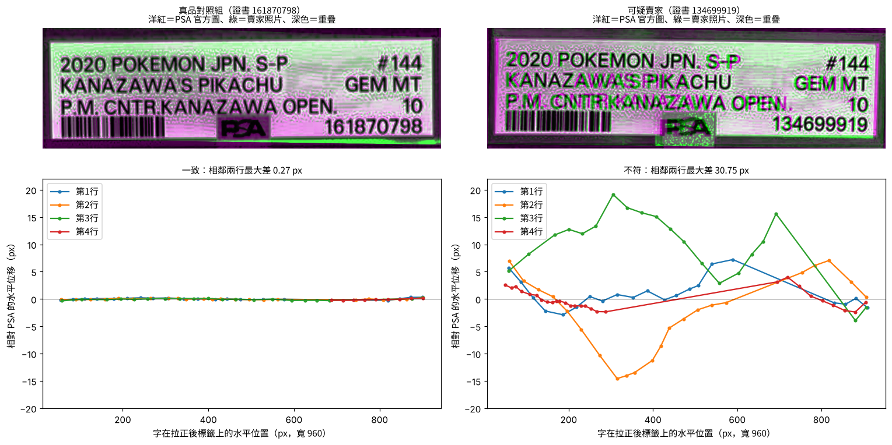

# PSA 標籤字距比對（PSA Label Alignment Check）

[English →](README.md)

這是一個 agent skill 加命令列工具，用來判斷**賣家照片裡的 PSA 卡殼標籤是不是 PSA 原廠印的**。做法是拿同一張證書在 PSA 官網上的圖片，逐字比對標籤的排版。

假卡殼通常會照抄真的鑑定編號，QR code 也掃得到，賣家甚至直接拿 PSA 官網的照片來用。所以「編號查得到」什麼都證明不了。仿冒業者最難做到的，是跟 PSA 一模一樣的字距排版。



## 原理

1. **把標籤拉正：** 找出兩張圖標籤的紅色外框，各自拉正成 960 × 291 px。
2. **逐字找位置：** 用正規化互相關，在賣家的標籤裡找出 PSA 標籤上每一個字的位置，精確到次像素。
3. **去除整體變形：** 用一個整體的單應性矩陣消除拍攝角度和鏡頭變形，然後再量一次。
4. **比較相鄰兩行：** 看相鄰兩行在同一個水平位置的位移有沒有差別。
   - 同一張標籤翻拍：每一行一起移動，差距不到 1px。
   - 重新排版印的假標籤：各行往不同方向偏，差距達到幾十 px。

| 結果 | 相鄰兩行最大差距 | 代表 |
|---|---|---|
| `CONSISTENT` 一致 | ≤ 4px | 排版跟 PSA 一致，很可能是 PSA 原廠標籤 |
| `MISMATCH` 不符 | ≥ 8px | 排版跟 PSA 不同，可能是重新印的假標籤 |
| `INCONCLUSIVE` 無法判斷 | 4–8px，或比對到的字太少 | 請賣家補一張更正面、更清楚的照片 |

目前的校準結果：

| 比較的照片 | 相鄰兩行最大差距 |
|---|---|
| 真品 | **0.27px** |
| 真品照片 vs 同款卡另一張證書的 PSA 官方圖 | 0.22px |
| 假品 | **30.75px** |

## 使用方式

```bash
pip install -r requirements.txt
python skills/psa-label-alignment/scripts/psa_label_check.py \
    --ref  PSA官網正面圖.png \
    --test 賣家正面照.jpg \
    [--test-back 賣家背面照.jpg --cert 鑑定編號] \
    --out out/
```

- **`--ignore-cert-line`：** 參考圖用的是**同一款卡、但不同證書**時加上這個參數。PSA 對同一張卡的說明文字排版完全一樣，所以只會略過最下面那一行鑑定編號。
- **偵測不到紅框時：** 用 `--ref-corners` 或 `--test-corners "x,y;x,y;x,y;x,y"` 手動指定紅框四個角，順序是左上、右上、右下、左下。

## 安裝成 agent skill

| Agent | 安裝方法 |
|---|---|
| Claude Code | 把 `skills/psa-label-alignment` 複製到 `~/.claude/skills/`，或專案裡的 `.claude/skills/` |
| Claude App | 把資料夾壓成 zip，上傳成自訂 skill |
| Codex、Cursor、Gemini CLI 等其他 agent | 把這個 repo 加進工作區，它們會讀 [`AGENTS.md`](AGENTS.md) |

只要能跑 Python 指令、讀 JSON，任何 agent 都可以用。

## 範例

| 範例 | 情況 | 結果 |
|---|---|---|
| [01-reprinted-label-suspect](examples/01-reprinted-label-suspect/) | 0 評價賣家，價格約行情七成，商品分類亂填 | **不符** 30.75px |
| [02-genuine-control](examples/02-genuine-control/) | 1,000 多個評價的賣家，價格在行情內 | **一致** 0.27px |

## 限制

- **只檢查標籤。** 如果是真的 PSA 卡殼被撬開、換了卡，這個工具抓不到。
- **需要賣家自己拍的照片。** 如果賣家只放 PSA 官網的圖，等於什麼都沒證明。
- **閾值是暫定的。** 目前只用兩張卡校準，歡迎提供更多已知真假的案例。
- 只支援標準紅框的 PSA 標籤，也只量水平方向。
- 這是初步篩選的工具，不能取代正式鑑定。高價卡請使用平台的鑑定服務。
